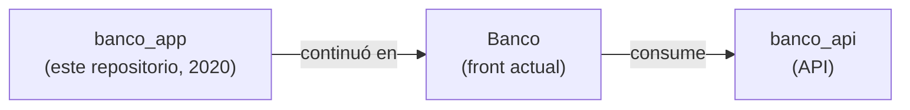

# banco_app

Primera versión del front del banco de ejemplo: la plantilla base de Vue 2 con el encabezado y el pie de página, todavía sin pantallas.

El proyecto continuó en **[Banco](https://github.com/juandavidalvarez9/Banco)**, que es la versión completa y actual: Vue 3, ingreso, consulta de saldo y retiros contra [banco_api](https://github.com/juandavidalvarez9/banco_api), con pruebas y capturas.

Este repositorio se conserva solo como historial. Para ejecutar o revisar el banco, usa `Banco`.
